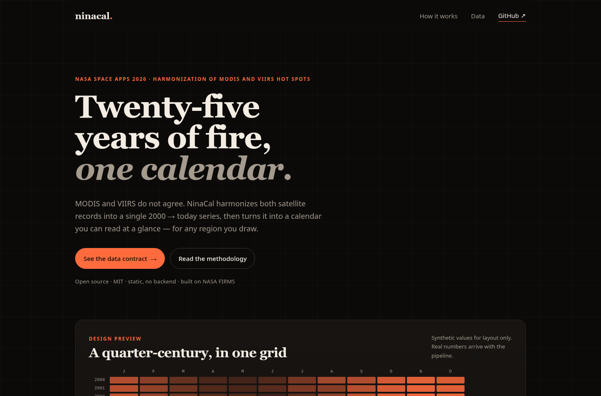

# NinaCal

**A 25-year fire activity calendar for any region you draw.**

[](LICENSE)
[](https://www.spaceappschallenge.org/)
[](https://firms.modaps.eosdis.nasa.gov/)
[](docs/ARCHITECTURE.md)

NinaCal takes the two satellite fire records that don't agree with each other — **MODIS**
(2000 →) and **VIIRS** (2012 →) — and harmonizes them into one continuous series. Then it
shows that series as a **year × month calendar of burning activity** for any area you
select, compares the **current month against the historical median**, flags anomalies, and
lets you **download the numbers**.

Built in the open for the [NASA Space Apps Challenge 2026](https://www.spaceappschallenge.org/)
challenge *Harmonization of MODIS and VIIRS Hot Spots*.



> A thermal hotspot is not a confirmed fire. NinaCal reports satellite detections, not
> fire incidents. See [limitations](docs/limitations.md).

## What it does

- **Pick a region.** Draw a polygon on the map or type a bounding box, then choose a date
  range.
- **See 25 years at a glance.** A calendar heatmap (year × month) built from a single
  harmonized series, not two incompatible ones.
- **Compare with history.** The current month next to the median of the same month in
  previous years, plus a standardized anomaly.
- **Trust the calibration.** The MODIS ↔ VIIRS overlap is validated on held-out years, and
  the validation chart ships with the app.
- **Take the data.** Export the selection as CSV: harmonized counts per 0.1° cell and month.

## How it works

```text
NASA FIRMS CSVs (MODIS + VIIRS S-NPP)
        │
        ▼
pipelines/                      Python, runs offline on a laptop
  aggregate to 0.1° cells       → monthly counts per product
  calibrate on the 2012→ overlap
        │
        ▼
data/processed/{year}.json      git-committed, one file per year
        │
        ▼
apps/web/                       Next.js static export, no backend
  load JSON on demand → filter cells by region → sum → charts + CSV
```

The harmonization method, the validation protocol and its failure modes are documented in
[`docs/methodology.md`](docs/methodology.md). The data contract is defined once in
[`data/schemas/`](data/schemas/) and nobody changes it silently.

## Quick start

Requires Node.js ≥ 20.9. The app has no runtime backend, but the dev server uses Next.js.

```bash
git clone https://github.com/hanserlodev/ninacal.git
cd ninacal/apps/web
npm install
npm run dev        # http://localhost:3000
```

The web app starts against the sample data in `data/samples/mock.json`. Processed data is
generated by the pipeline:

```bash
python3 -m venv .venv && source .venv/bin/activate
pip install -r pipelines/requirements.txt
# see pipelines/README.md for the expected inputs and outputs
```

Everything else:

```bash
make check         # repo + data-contract checks (also runs in CI)
make build         # static production build in apps/web/out
make help          # list targets
```

## Repository layout

```text
ninacal/
├── apps/web/              # Next.js app (static export): MapLibre map, ECharts calendar
├── pipelines/             # Python aggregation + calibration (offline)
├── data/
│   ├── samples/mock.json  # tiny fixture with the real row shape
│   ├── processed/         # {year}.json generated by the pipeline
│   └── schemas/           # JSON Schema for every committed data file
├── docs/                  # methodology, data dictionary, limitations, decisions
├── scripts/check.sh       # cheap checks: files, JSON, contract, whitespace
└── .github/               # CI, issue/PR templates, dependabot
```

## Data contract

`data/processed/{year}.json` is an array of rows. One row = one 0.1° cell, one month:

```json
{ "cell": "-10.2_-73.5", "y": 2019, "m": 9, "modis": 12, "viirs": 51, "harm": 12.4 }
```

| Field    | Meaning                                                          |
| -------- | ---------------------------------------------------------------- |
| `cell`   | `lat_lon` anchor of the 0.1° grid cell (`-?\d+(\.\d+)?`).         |
| `y`, `m` | Year and month (1–12).                                           |
| `modis`  | Raw MODIS detection count.                                       |
| `viirs`  | Raw VIIRS S-NPP detection count (`0` before 2012).               |
| `harm`   | Harmonized count in **MODIS-equivalent** units. The calendar uses only this field. |

Rules: **missing data is `null`, never `0`**; the grid anchor is fixed and documented in
[docs/data-dictionary.md](docs/data-dictionary.md); the harmonized series is MODIS before
2012 and calibrated VIIRS from 2012 onward.

## Documentation

- [Methodology](docs/methodology.md) — aggregation, calibration, validation, plan B.
- [Data dictionary](docs/data-dictionary.md) — every field, type and null rule.
- [Limitations](docs/limitations.md) — what the data can and cannot tell you.
- [Architecture](docs/ARCHITECTURE.md) — why a static app and how it stays fast.
- [Submission checklist](docs/CHECKLIST.md) — what "done" means for the hackathon.
- [Pitch & video script](docs/pitch.md) — the 30-second story.
- [Decision log](docs/decisions/) — architecture decisions with context.

## Team

| Role                | Owns                                                  |
| ------------------- | ----------------------------------------------------- |
| **Hans**            | Tech lead, frontend, integration, deployment          |
| **Data**            | FIRMS pipeline, harmonization, calibration, schemas   |
| **Pitch**           | Research, methodology text, video, copy, QA           |

## Contributing

Issues, ideas and PRs are welcome — see [CONTRIBUTING.md](CONTRIBUTING.md). By
participating you agree to the [Code of Conduct](CODE_OF_CONDUCT.md). For security reports,
follow [SECURITY.md](SECURITY.md).

## License

[MIT](LICENSE) © 2026 NinaCal contributors. Data © NASA FIRMS / EOSDIS, used under NASA's
open data policy.
